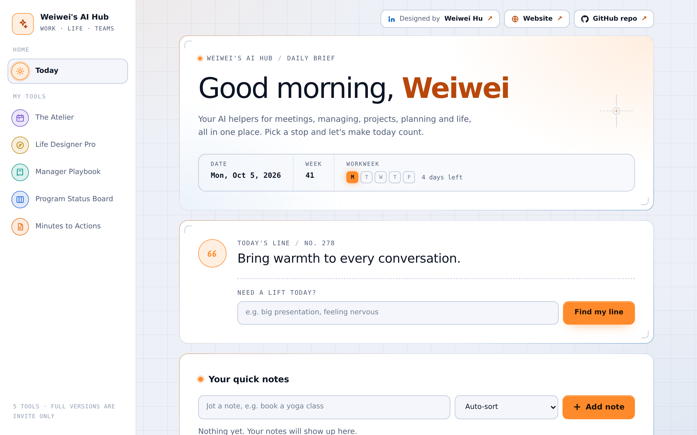
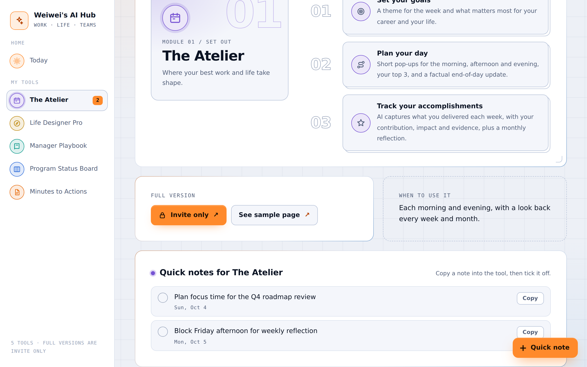
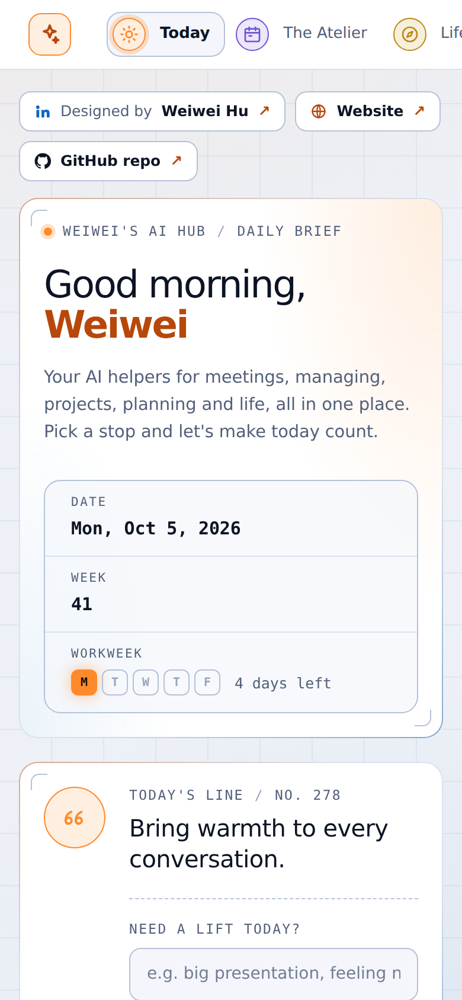
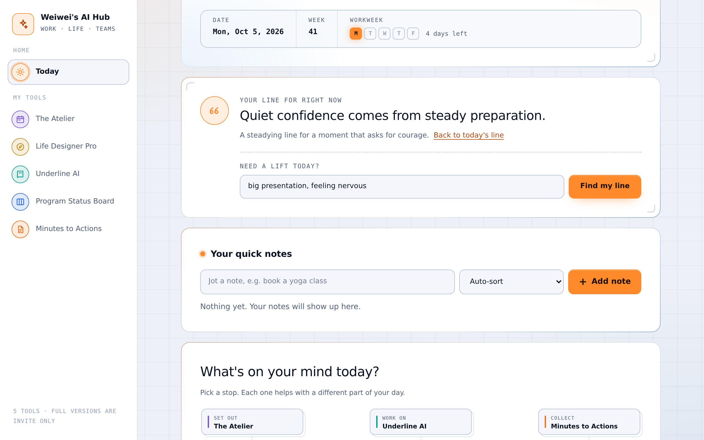
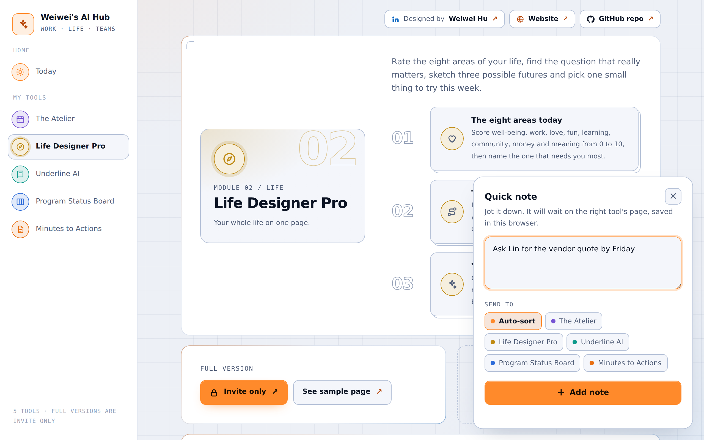
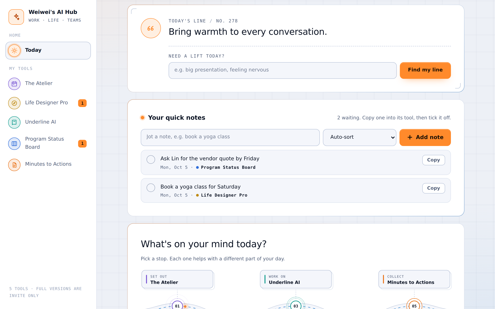

# Weiwei's AI Hub

**🌐 Live page: [wei-wei-hu.github.io/ai-hub](https://wei-wei-hu.github.io/ai-hub/)**

Your AI helpers for meetings, managing, projects, planning and life, all in one place, by Weiwei Hu. Pick a stop on the road and see how each tool can help your day.

### [Open the AI Hub →](https://wei-wei-hu.github.io/ai-hub/)

It opens in your browser on a phone or laptop. Nothing to install, and no sign-in.

<a href="https://wei-wei-hu.github.io/ai-hub/"><picture><source media="(prefers-color-scheme: dark)" srcset="docs/preview-laptop-dark.png"></picture></a>

## What's inside

The **Today** page greets you with the date, the week number and how many workdays are left. Further down, a timeline has one stop for each tool.

| # | Tool | What it helps with |
|---|------|--------------------|
| 01 | **Life Designer Pro** | Think through the life behind your next decision. Free and private, in your browser. [Open the Life Canvas](https://wei-wei-hu.github.io/life-designer-pro/) |
| 02 | **Underline AI** | Bring one situation. Leave with a one-page actionable plan. [See the page](https://wei-wei-hu.github.io/underline-ai/) |
| 03 | **The Atelier** | Where your best work and life take shape. [See an example](https://wei-wei-hu.github.io/the-atelier/#introExample) · [Start free trial](https://wei-wei-hu.github.io/the-atelier/) |
| 04 | **Program Status Board** | Projects, milestones and the weekly update. [See the page](https://wei-wei-hu.github.io/program-management/) |
| 05 | **Minutes to Actions** | Meeting notes in, minutes and action items out. |

Each tool has its own page. It explains what the tool does in three steps and suggests when to use it.

  <a href="https://wei-wei-hu.github.io/ai-hub/"><picture><source media="(prefers-color-scheme: dark)" srcset="docs/preview-tool-dark.png"></picture></a>
  <a href="https://wei-wei-hu.github.io/ai-hub/"><picture><source media="(prefers-color-scheme: dark)" srcset="docs/preview-phone-dark.png"></picture></a>

## Today's line and "Need a lift today?"

Every day the Hub shows a short line to start the day well. There are 366 of them, one for each day of the year, so none repeats within a year.

Want a line that fits your day? Type what's on your mind, such as "big presentation, feeling nervous," and tap **Find my line**. The Hub picks the line that matches best and tells you why it fits.

<a href="https://wei-wei-hu.github.io/ai-hub/"><picture><source media="(prefers-color-scheme: dark)" srcset="docs/preview-lift-dark.png"></picture></a>

## Quick note

Right under Today's line, a note box sits above your list of notes. Type a thought, leave **Auto-sort** on and tap **+ Add note**. The Hub sends it to the tool where it fits, or you can pick a tool yourself.

- Your notes appear in the list just below the box, each with the tool it belongs to.
- On a tool's page, tap **+ Quick note** at the bottom right to add a note without going back. That page lists the notes waiting for its tool, and the sidebar shows a count.
- Tap **Copy** to paste a note into the tool, then tick the circle when it's done.
- Notes are saved in your own browser. Nobody else can see them, and nothing is sent anywhere.

  <a href="https://wei-wei-hu.github.io/ai-hub/"><picture><source media="(prefers-color-scheme: dark)" srcset="docs/preview-quick-note-dark.png"></picture></a>
  <a href="https://wei-wei-hu.github.io/ai-hub/"><picture><source media="(prefers-color-scheme: dark)" srcset="docs/preview-notes-dark.png"></picture></a>

## Full versions

The Atelier has a [7-day free trial](https://wei-wei-hu.github.io/the-atelier/). Start the trial there, and membership unlocks from it. Underline AI has a [free trial](https://wei-wei-hu.github.io/underline-ai/) and [full access](https://buy.stripe.com/cNi14nfzP6RKfkX9F2eQM00). The full versions of the other tools are **invite only**. To learn more, visit [Weiwei Hu on LinkedIn](https://www.linkedin.com/in/weiweihu/).

- Live page: https://wei-wei-hu.github.io/ai-hub/
- Website: https://weiweihu.carrd.co/
- LinkedIn: https://www.linkedin.com/in/weiweihu/

## License

This repository is **proprietary and view-only**. It is not open source. You may view it and use the live page for personal, non-commercial use, and you may link to the live page. Copying, changing, reusing, hosting, selling, embedding or imitating any part of it requires written permission from Weiwei Hu. Scraping it, and using it to train or test any AI system, is not allowed. See [LICENSE](LICENSE) for the full terms.

© 2026 Weiwei Hu. All rights reserved.
